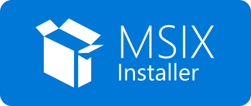

# Tray Clock

World clocks, a stopwatch, and timers in a tray flyout.

Tray Clock is a WinUI 3 app that lives in the Windows notification area. It has no main window: the tray icon opens a small flyout next to the icon.

## Features

- **Clocks:** your local time plus any cities you add (search by name), with day, offset from local, and a sun or moon for daytime. Drag the compare slider up to 12 hours either way to see that moment in every city. Reorder or remove cities from the row's "…" button or context menu, by dragging, or by swiping to delete.
- **Stopwatch:** start, pause, lap, and reset, with each lap's split and the fastest and slowest laps marked. "Copy laps as a table" in the "…" menu puts them on the clipboard ready to paste into Excel or another spreadsheet. It keeps running while the flyout is closed.
- **Timers:** presets or a custom duration, several at once, each showing when it will end. A finished timer beeps, opens the flyout, and keeps going off (a pulsing card and a swinging bell) until you dismiss or restart it. Dismissing sets it back to its full time, ready to start again.
- **Tray menu:** right-click for Open, Start/Pause stopwatch, Repeat timer, Settings, and Exit.
- **Settings:** Start with Windows, shown inside the flyout.
- **Theme-aware:** the tray icon and flyout follow the Windows taskbar theme.
- **Single instance:** launching again opens the running instance's flyout.

## Install

[](https://github.com/Tray-Land/tray-clock/releases/latest/download/TrayClock.appinstaller)

Requires Windows 10 1809 or later, x64 or ARM64. Download [TrayClock.appinstaller](https://github.com/Tray-Land/tray-clock/releases/latest/download/TrayClock.appinstaller) and open it. Windows installs the right version for your PC and keeps it updated.

## Privacy and footprint

No network calls and no accounts. Settings (the city list) are stored in the app's local settings. The only background work is a single timer aimed at the next countdown to finish, so a finished timer can alert you while the flyout is hidden. The flyout closes after a minute hidden and memory is returned to Windows.

## Build from source

Prerequisites: .NET 10 SDK, Developer Mode, and `winget install Microsoft.WinAppCli`.

```powershell
winapp run          # or: dotnet run
dotnet test TrayClock.Tests
.\build-msix-for-gh.ps1   # signed x64 + ARM64 .msixbundle, auto-updating .appinstaller feed, draft GitHub release
```

To release: bump `Identity/@Version`, run `.\build-msix-for-gh.ps1`, publish the draft without changing its tag, then run `.\build-msix-for-gh.ps1 -VerifyPublished`.

## License

MIT, see [LICENSE](LICENSE).
